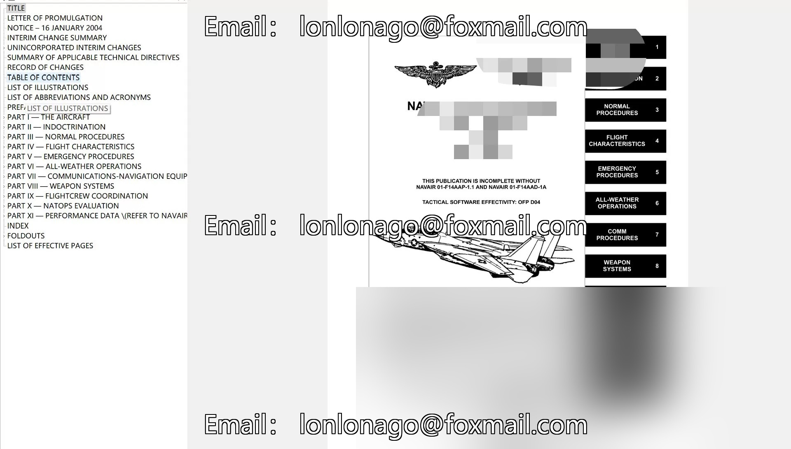
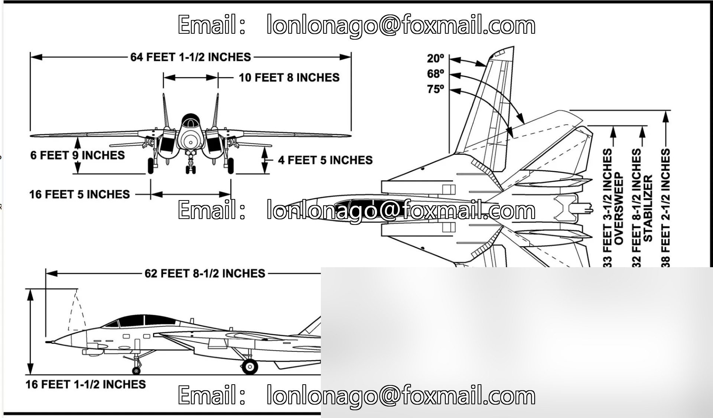
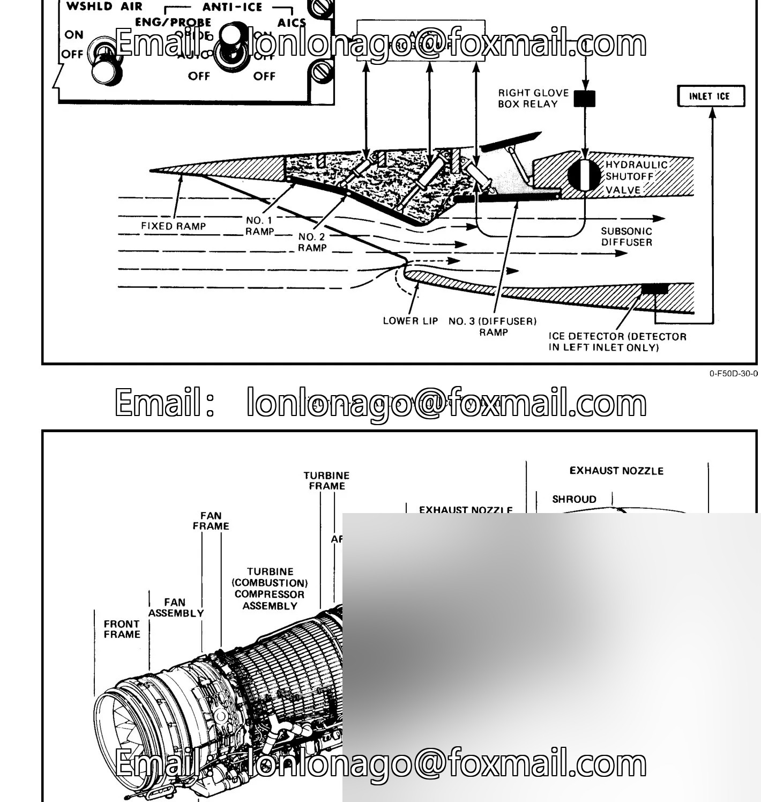
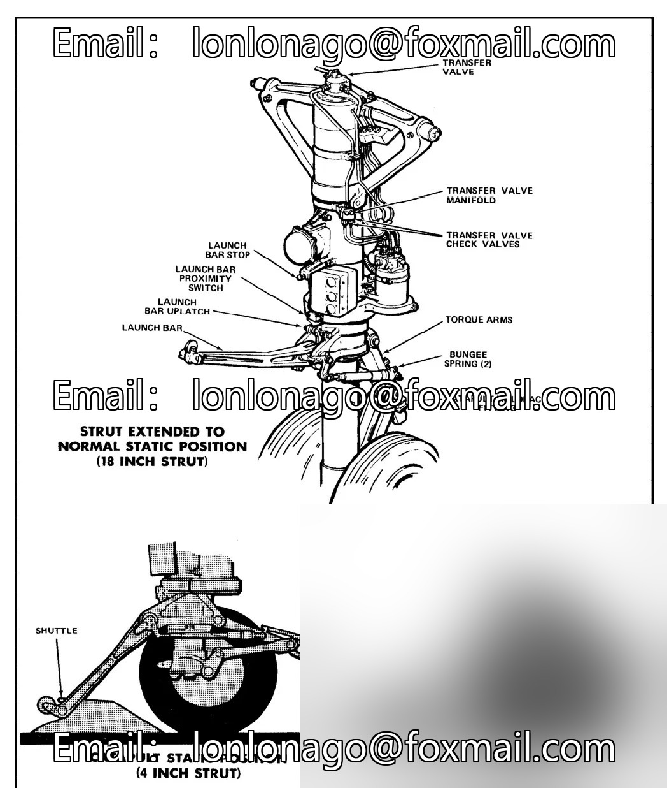
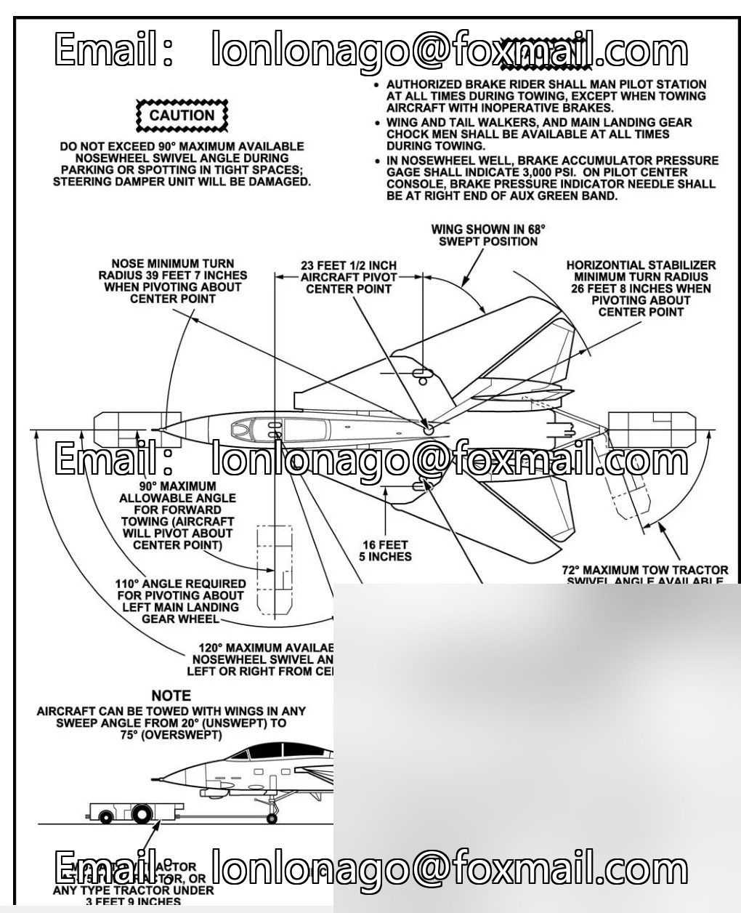

# The sole official and mandatory flight operation manual for the F-14D model!

## Body

The only official, mandatory flight operation guide for the F-14D aircraft!
The highest authoritative technical specification and operation procedure document released by the U.S. Navy Aviation System Command (NAVAIR) regarding the F-14D “Seal” aircraft.
1. Nature and status of the manual

Name: NATOPS Manual (Naval Air Training and Operating Procedures Standardization, Naval Air Training and Operating Procedures Standardization Manual)

Status: This is the official and mandatory flight operation bible for the F-14D type. All pilot, ground, and maintenance personnel must strictly abide by its regulations, which is the fundamental basis for ensuring flight safety, tactical execution, and equipment maintenance.

Version: The cover displays a version released on April 15, 2002, and a Change 2 was published on January 15, 2004, ensuring the timeliness and accuracy of the content.

2. Core content architecture (parsed from the table of contents)

The manual adopts a highly standardized structure, comprehensively covering every aspect from understanding aircraft to executing complex tasks.

PART I — THE AIRCRAFT (aeroplane introduction): system overview, enabling pilots to comprehensively understand the equipment they pilot.

PART II — INDOCTRINATION (Beginning Guide): Basic guidance for new pilots.

PART III — NORMAL PROCEDURES (normal procedures): all standard operating processes during daily flights, which are the foundation of safe flight.

PART IV — FLIGHT CHARACTERISTICS (Flight Characteristics): Detailed explanation of the control performance and characteristics of the airplane under various states, such as the stall and spiral.

PART V — EMERGENCY PROCEDURES (EMERGENCY PROCEDURES): The top priority, including a standardized handling checklist for all possible faults and emergencies (such as engine shutdown, hydraulic system failure, fire, etc.), which is essential for rescuing the aircraft and saving lives.

PART VI — ALL-WEATHER OPERATIONS (ALL-WEATHER Operations): Special procedures for complex weather and nighttime flights.

VII — COMMUNICATION-NAVIGATION EQUIPMENT (Communication-navigation equipment): Operation guide for onboard electronic system.

PART VIII — WEAPON SYSTEMS (Weapons Systems): operating procedures for controlling and using various weapons on board, which embodies the core combat capability of the F-14 as an anti-aircraft weapon for a fleet.

PART IX — FLIGHTCREW COORDINATION (Flight Crew Coordination): Standardize the collaboration procedure for the dual human-device groups of pilots and radar interception officers (RIO).

PART X — NATOPS EVALUATION (NATOPS evaluation): the assessment criteria for the evaluation of a pilot's proficiency in this manual.

PART XI — PERFORMANCE DATA (Performance Data): Provides detailed aircraft performance charts (such as takeoff distance, climb rate, fuel consumption, etc.), for mission planning.

3. Summary: Core value

This manual is not just a specification; it represents a complete knowledge system and safety standards. It ensures:

Operation standardization: Regardless of which pilot operates, their basic operations are unified and predictable.

Extreme safety: By summarizing countless hours of flight experience, transform best practices and blood-tears lessons into mandatory regulations that must be strictly observed.

Combat-readiness reliability: is the technical guarantee that ensures the complex weapon system can be deployed into combat at any time.

In summary, what you see is an ultimate guide on how the F-14D "Mongoose" fighter aircraft is safely and efficiently commanded, which is a institutional reflection of the naval aviation forces' combat capabilities.

The F-14D flight operation bible is issued as a NATOPS Manual covering aircraft introduction, training guidance, normal procedures, flight characteristics and emergency procedures, along with change records, illustrations, abbreviations and tables.

<!-- AI_ENRICHED -->

## Images

## Payment

Here is a pay link on Stripe ( https://buy.stripe.com/3cs8yP7sY87d0vu9AB ). Please contact me lonlonago@foxmail.com after funding $89, and I will send you a complete data files , thank you!

